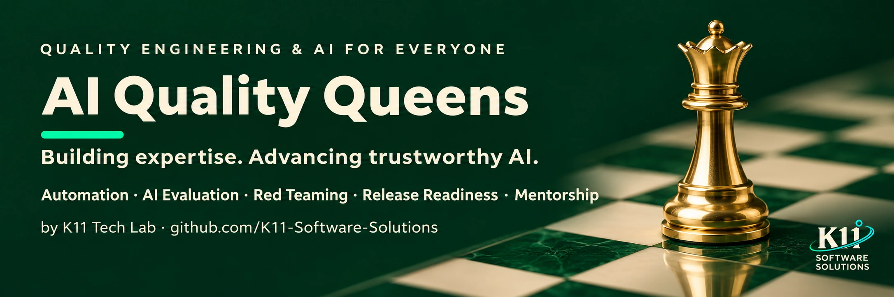
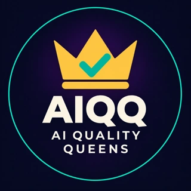

# ♛ ai-quality-queens

**AI Quality Queens** is a community learning guide for testers, from designing a first boundary test to evaluating an AI agent’s decisions. The QA Queens here are our sisters and mothers. They are also the colleagues who review a first test script, share what they learned from a failed run, or make time for someone rebuilding a career. Our primary goal is to help the QA community while challenging ourselves to learn something each day.

## Choose your starting position

| Level | Responsibilities |
|---|---|
| Beginner | **Design a test.** Pick a business rule, write down what should happen at its boundary, and explain how you would recognize a defect. [Test automation fundamentals](qa_foundational_knowledge/quality-engineering/test-automation-fundamentals/README.md) |
| Developing | **Automate a check.** Turn that boundary into a repeatable test. Change the input by one unit and check whether the failure message tells you what went wrong. [Java tutorials and examples](qa_foundational_knowledge/quality-engineering/test-automation-in-java/README.md) · [Python and pytest](qa_foundational_knowledge/quality-engineering/test-automation-in-python/README.md) · [Data structures and algorithms in Java](qa_foundational_knowledge/DSA-training/README.md) |
| Intermediate | **Test across systems.** Follow one order from reservation through shipment. Decide which checks belong at the API, browser, or database layer and what evidence connects them. [Domain knowledge exercises](domain_knowledge_exercises/README.md) · [Nine hands-on QA projects](practice-qa-projects/README.md) |
| Advanced | **Evaluate AI and agents.** Compare an AI-generated explanation with measured results. Inspect an agent’s trace to check whether it chose an appropriate tool and when it decided to stop. [AI-augmented performance testing](practice-qa-projects/performance-testing-jmeter/09-ai-augmented-performance-testing.md) · [Agentic QA for performance](practice-qa-projects/performance-testing-jmeter/10-agentic-qa-for-performance.md) · [AI quality engineering lab](practice-qa-projects/ai-quality-engineering/README.md) |

[Explore the quality engineering guides](qa_foundational_knowledge/quality-engineering/README.md) · [Read about Kavita’s testing experience](qa_foundational_knowledge/README.md)

## The queen’s strategy for AI quality

A chess queen has range, but bringing her out before developing the other pieces can cost several moves as she retreats under attack. The same discipline matters in AI testing. Before asking a model to judge quality, establish the rule, the test data, and the evidence you would trust enough to challenge its verdict.

- **Opening · Develop the fundamentals.** Suppose shipping becomes free at 5,000 cents. Test 4,999 and 5,000, then check the fee on the invoice. Those two examples give you a standard for reviewing any AI-generated cases. A suite can look thorough and still miss the exact point where the price changes.
- **Middlegame · Challenge one assumption each day.** Write your prediction before running a test. If an AI assistant calls a slowdown a database problem, identify the measurement that would distinguish a database delay from a queue elsewhere. Keeping a short record of prediction, evidence, and revision builds the mental discipline to advance beyond familiar tools. When a topic feels out of reach, shrink it to one experiment you can explain to a peer.
- **Endgame · Know when to pause.** A layoff or an uncertain hiring cycle can interrupt even a well-planned career. On a difficult day, a few quiet minutes of mindfulness or meditation can be a way to pause before choosing what feels manageable. That might mean tracing one failed test, calling a colleague, or simply resting. There is room in this community both to offer help and to receive it.

### Mastering the Queen’s Power

Before moving your queen, ask yourself: *What can she threaten from here, and what will she stop defending?* Bring that question to a test review. Moving a slow checkout check from the browser to the API gives you faster feedback on pricing. Which browser check still proves that the customer can see the quoted price?

**Try a queen fork.** A well-placed queen can threaten a rook and a knight at the same time. In the shipping lab, choose a cart that just qualifies for free shipping. Compare the quote at checkout with the fee on the invoice. If checkout promises free shipping but the invoice adds a fee, you have a concrete discrepancy to investigate.

**Replay the position.** Chess players pause over a master game, choose a move, then study what happened. At your next QA Queens practice session, give a partner the requirement and the initial failure from a resolved bug. Keep the diagnosis hidden. Each of you writes down the check you would run next and what you expect to learn. Then reveal the original investigation and share a clue that changed your thinking.

## Make a move for the next learner

Contributors at every level are welcome. A beginner who spots a missing setup step can make a tutorial easier for everyone who follows. An experienced tester can contribute a realistic failure case, a domain exercise, or an agent trace that shows how a plausible answer went wrong.

[Open an issue](https://github.com/kavitaj11/ai-quality-queens/issues) to ask a question, report a confusing step, or propose a lesson. To contribute a change, fork the repository, update the relevant guide or lab, and [open a pull request](https://github.com/kavitaj11/ai-quality-queens/compare). Tell reviewers who the change helps, what you tried, and what another learner should observe.

[Read the contribution guidelines](CONTRIBUTING.md) for lesson structure, verification, and pull request expectations.

## License

The code examples use the MIT License. The training materials use Creative Commons Attribution 4.0 International (CC BY 4.0). See the [license and attribution guide](LICENSE).
